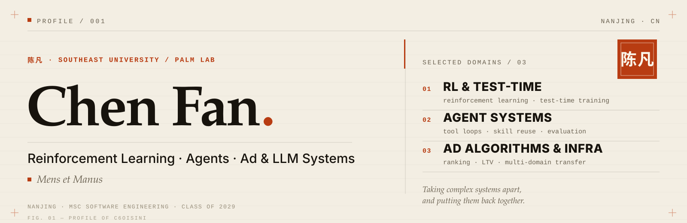

  <picture>
    <source media="(prefers-color-scheme: dark)" srcset="./assets/hero-dark.svg">
    <source media="(prefers-color-scheme: light)" srcset="./assets/hero-light.svg">
    
  </picture>

  
  
  

  <code>VLM</code>&nbsp; <code>Agent Systems</code>&nbsp; <code>LLM Serving</code>

  <a href="#中文">中文</a> · <a href="#english">English</a>

---

## 中文

### 你好，世界

我是**陈凡**（Chen Fan），东南大学软件工程硕士在读，在 **PALM 实验室**做视觉语言模型与 Agent 方向的研究；本科毕业于湖南科技大学信息安全专业。

> 把复杂系统拆开、讲清楚，再重新组装成有用的东西。

### 我在做什么

- **研究**：视觉语言模型 · Agent 系统 · 弱监督学习 · 分布外泛化 · 持续学习
- **工程**：LLM 推理与服务 · 训练基础设施 · Agent 工具循环
- **经历**：字节跳动 Pangle 算法实习（2026.03–2026.09），做广告排序与多域迁移

### 论文

- **BPGT** — *A Novel Privacy-Preserving K-Means Clustering Framework to Guarantee Local dχ-privacy*  
  SecureComm 2025（CCF-C）· 第一作者 · [code](https://github.com/C6oisini/BPGT)
- **FedDAR** — *Multidimensional Contribution Assessment and Adaptive Gradient Rewards for Collaborative Fairness in Heterogeneous Federated Learning*  
  ICIC 2025（CCF-C）· 共同作者

### 找到我

[Email](mailto:2194457208@qq.com) · [GitHub](https://github.com/C6oisini)

## English

### Hello, world

I'm **Fan Chen** (陈凡), a master's student in software engineering at **Southeast University**, working on vision-language models and agent systems in the **PALM Lab**. I did my undergraduate work in information security at Hunan University of Science and Technology.

> Take complex systems apart, explain them clearly, and put them back together into something useful.

### What I work on

- **Research** — vision-language models, agent systems, weak supervision, out-of-distribution generalization, continual learning
- **Engineering** — LLM inference and serving, training infrastructure, agent tool loops
- **Previously** — algorithm intern at ByteDance Pangle (2026.03–2026.09), working on ad ranking and multi-domain transfer

### Publications

- **BPGT** — *A Novel Privacy-Preserving K-Means Clustering Framework to Guarantee Local dχ-privacy*  
  SecureComm 2025 (CCF-C) · first author · [code](https://github.com/C6oisini/BPGT)
- **FedDAR** — *Multidimensional Contribution Assessment and Adaptive Gradient Rewards for Collaborative Fairness in Heterogeneous Federated Learning*  
  ICIC 2025 (CCF-C) · co-author

### Find me

[Email](mailto:2194457208@qq.com) · [GitHub](https://github.com/C6oisini)

---

  Plain SVG · Shields.io · GitHub Profile README

