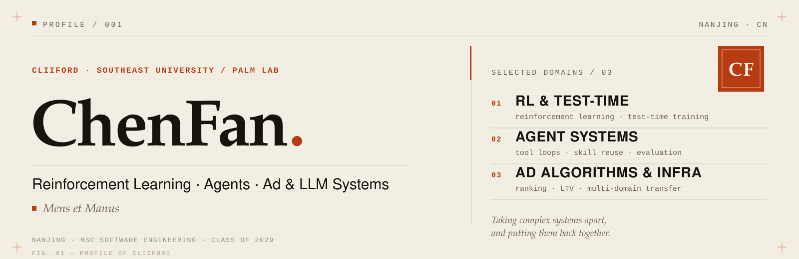

  <picture>
    <source media="(prefers-color-scheme: dark)" srcset="./assets/hero-dark-v2.svg">
    <source media="(prefers-color-scheme: light)" srcset="./assets/hero-light-v2.svg">
    
  </picture>

  
  
  

  <code>Reinforcement Learning</code>&nbsp; <code>Agent Systems</code>&nbsp; <code>Ad Algorithms &amp; Infra</code>

---

## Hello, world

I'm **ChenFan (CliiFord)**, a master's student in software engineering at **Southeast University**, working on reinforcement learning and agent systems in the **PALM Lab**.

> Mens et Manus.

## What I work on

- **Research** — vision-language models, agent systems, reinforcement learning, test-time training
- **Engineering** — ad algorithm modeling and infrastructure, agent tool loops
- **Previously** — algorithm intern at ByteDance Pangle (2026.03–2026.09)

## Find me

[Email](mailto:C6oisini@gmail.com) · [GitHub](https://github.com/C6oisini)

---

  Plain SVG · Shields.io · GitHub Profile README

