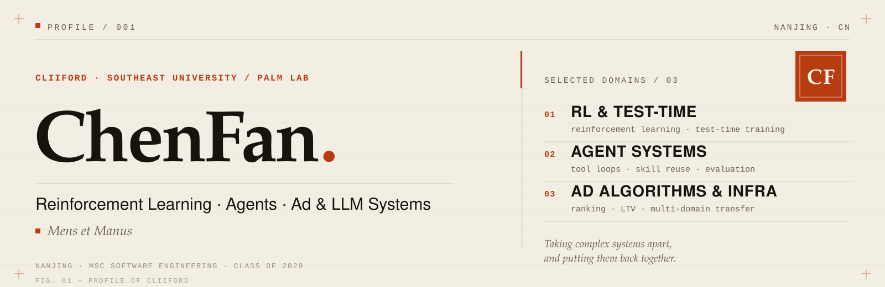

# Hero 图与主页维护

这个仓库就是 GitHub 个人主页仓库（仓库名 = 用户名 `C6oisini`）。README 里的显示名是 `ChenFan (CliiFord)`；`CliiFord` 是显示别名，GitHub 账号和仓库仍然是 `C6oisini`。主页顶部的 hero 图是两张提前画好的 SVG，由 `make_hero.py` 生成；README 只负责引用它们。

| 你看到的部分 | 实际来源 |
| --- | --- |
| 头像、名字、学校、邮箱、关注数 | GitHub 个人资料设置，不是 README |
| 大字名字、索引栏、字母章 | `assets/hero-light-v2.svg` / `hero-dark-v2.svg` |
| followers / profile views / email 小徽章 | Shields.io、komarev.com 动态图片 |
| 成就徽章（YOLO、Pull Shark 等） | GitHub 自动发放，不能自己加 |

README 不支持 CSS 和 JavaScript，所以那张“纸面海报”不是网页，而是一张 SVG 图片。风格是编辑排版 / 印刷品：纸面底色、衬线大字、朱红字母章、细线索引，没有渐变、发光和玻璃卡片。

## 文件结构

```text
C6oisini/
├── README.md
├── SETUP.md
├── make_hero.py
├── assets/
│   ├── bytedance-dark.svg
│   ├── bytedance-light.svg
│   ├── hero-light-v2.svg
│   └── hero-dark-v2.svg
├── preview-light.png
└── preview-dark.png
```

`preview-*.png` 只是本地预览，README 不引用，可以删。

`bytedance-*.svg` 是 README 实习区用的 ByteDance 字标，来自 Wikimedia Commons 的 `File:ByteDance logo English.svg`；深色版只把字标改成米白，彩色条保留。商标归 ByteDance 所有，这里仅用于标识实习经历。

## 改 hero 图

头图里的名字、别名、标语不在 `README.md` 里，而在 `make_hero.py` 顶部的变量里：

```python
NAME = "ChenFan"
ALIAS = "CliiFord"
MONOGRAM = "CF"
LABEL = "PALM LAB"
SCHOOL = "SOUTHEAST UNIVERSITY"
TAGLINE = "Reinforcement Learning · Agents · Ad & LLM Systems"
MOTTO = "Mens et Manus"
LOCATION = "NANJING · CN"
CLASS_OF = "2029"
ASSET_VERSION = "v2"  # bump when the SVG changes, then update README paths

DOMAINS = [
    ("01", "RL & TEST-TIME", "reinforcement learning · test-time training"),
    ("02", "AGENT SYSTEMS", "tool loops · skill reuse · evaluation"),
    ("03", "AD ALGORITHMS & INFRA", "ranking · LTV · multi-domain transfer"),
]
```

改完运行：

```bash
python3 make_hero.py
```

会重新生成 `assets/hero-light-v2.svg` 和 `assets/hero-dark-v2.svg`。文件名里的 `v2` 来自 `ASSET_VERSION`；改图后把它递增，并同步改 README 里的路径。脚本只用 Python 标准库，不需要装依赖。

- **名字太长**：把 `font-size="132"` 改小，例如 `110`，再重新生成。
- **换配色**：改 `PALETTES` 里的 `paper`、`ink`、`muted`、`accent`、`accent_ink`。
- **加/减方向**：改 `DOMAINS`，同时把右侧 `SELECTED DOMAINS / 03` 里的 `03` 改成实际条数。
- **看效果**：直接用浏览器打开 SVG，或看 `preview-*.png`。

版式是固定坐标（1600×520）：左侧名字与标语，中间竖线，右侧三条索引，右上角朱红字母章，四角裁切标记。改长文本时注意别越过 x=944 的竖线。

## 改 README

- 顶部用 `<picture>` + `prefers-color-scheme` 自动切换亮/暗两张 SVG，路径是相对仓库根目录的 `./assets/...`。
- 徽章颜色 `b83c12` 对应 SVG 里的朱红，`17130d` 对应墨色；换配色时一起改。
- README 现在是纯英文，没有语言切换锚点；hero 里的姓名也已经是 `ChenFan` / `CliiFord`，没有中文。改文案时不要再加中文段落。
- 邮箱在 README 里出现两次（徽章 + `Find me` 文字链接），改的时候一起改。

## 发布

```bash
git add -A
git commit -m "Update profile"
git push
```

个人主页仓库必须是 **Public**，且仓库名和用户名完全一致，GitHub 才会把根目录的 `README.md` 显示在 `https://github.com/C6oisini`。

## 个人资料

这些不在 README 里，在 GitHub 右上角头像 → **Settings → Public profile**：

- **Profile picture**：头像
- **Name**：显示名
- **Bio**：一句话简介
- **Company**：学校或公司
- **Location**：城市
- **Website**：个人网站
- **Email**：公开邮箱（可以不公开）

关注数、仓库数、成就徽章都是 GitHub 自动显示的，不需要也不允许手动做。

## 常见问题

**主页没有出现 README？**

依次检查：仓库是不是 Public；仓库名是否和用户名完全一致；`README.md` 是否在仓库根目录。

**图片不显示？**

路径必须和实际文件名大小写一致：

```html

```

**改了图但主页还是旧图？**

GitHub 的图片走 Camo 缓存，通常几分钟，偶尔更久。最稳的做法是换文件名：把 `make_hero.py` 里的 `ASSET_VERSION`（现在是 `v2`）改成 `v3`，重新生成，再把 README 里两处 `hero-*-v2.svg` 改成 `hero-*-v3.svg`。临时也可以在图路径后加 `?v=N`（每次更新把 N 递增）并同步改 `<source>` 和 ``。

**亮色/暗色怎么自动切换？**

`<picture>` + `prefers-color-scheme`，GitHub 会根据当前主题选择 `hero-light-v2.svg` 或 `hero-dark-v2.svg`。

**为什么不能直接写 CSS？**

GitHub 会过滤 README 里的 `<style>`、`<script>` 和大部分 `style` 属性。想要复杂排版，就把排版画进 SVG / PNG，再当普通图片引用。

**README 为什么没有中文？**

现在是纯英文 README；hero 里的姓名也改成了 `ChenFan` / `CliiFord`，不再出现中文名。改文案时不要再加中文段落。

## 设计说明

- 字体走系统字体栈：衬线用 Iowan Old Style / Palatino / Georgia，无衬线用系统 UI 字体，等宽用 SF Mono / Menlo。不加载外部字体，GitHub 上也不会因为字体请求失败而变形。
- 没有位图、没有外部资源，SVG 单文件约 8 KB，任意缩放都清晰。
- 1600×520 在 GitHub 的约 880 px 正文宽度下会缩到一半左右，所以主标题用 132 px，最小字号保持在 12–15 px。
